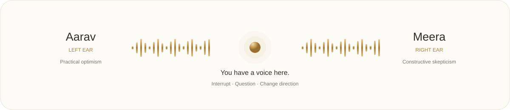

# Stereo Sabha

### Two voices. Your perspective.

**A live voice room where two AI agents talk to each other, and you can jump in.**

[Get started](#get-started) · [How it works](#how-it-works) · [Try a conversation](#try-a-conversation) · [Development](#development)

---

Most chat apps give you one reply at a time. Here, two voices build a conversation while you listen, challenge a point, or take it somewhere else.

Aarav speaks in your **left ear**. Meera speaks in your **right ear**. Your microphone gives you the floor whenever you need it. They share the conversation history, including your contributions, and can agree, push back, or change their minds.

Brand artwork and routing illustration. The live app animates its waves from actual audio amplitude.

## Inside the room

- **Two distinct perspectives.** Aarav starts with practical optimism. Meera starts with constructive skepticism. Debate a topic or negotiate as buyer and seller.
- **A real place for your input.** Speaking cancels the current turn and stops queued audio. Both agents receive your contribution before continuing.
- **Hindi first.** Choose Hindi, English, or alternating English and Hindi rounds. Microphone transcription handles mixed language input.
- **Conversation that carries forward.** Full session history preserves earlier points. Each agent keeps your latest contribution pending until its reply finishes playing.
- **A quiet, tactile interface.** White and champagne gold, ceramic ear artwork, rounded recorder waves, clear speaker status, and a live transcript below the room.
- **A lightweight local app.** Python and browser audio handle the room. Sarvam handles inference. No local model download or GPU required in the default mode.

## Get started

You need **Python 3.11+**, a Sarvam API key with remaining credits, internet access, a modern Chrome or Edge browser, and stereo headphones. **Node.js 22+ is needed only for the JavaScript checks.**

### 1. Clone and install

~~~powershell
git clone https://github.com/therealsaitama/stereo-sabha.git
cd stereo-sabha
Set-ExecutionPolicy -Scope Process -ExecutionPolicy Bypass
.\setup.ps1
~~~

### 2. Configure once

Copy the example, then edit the new local file:

~~~powershell
Copy-Item .env.example .env
notepad .env
~~~

Set your own values:

~~~dotenv
SARVAM_API_KEY=your_sarvam_key
VOICE_ARENA_FREE_CREDITS_CONFIRMED=1
~~~

Set the confirmation flag to **1 only after checking that you have free credits left and intend to use those credits**. This flag records your declaration; it does not inspect or cap your account balance. The app can use provider credits, but it cannot distinguish free credits from paid credits.

The ignored local file is loaded automatically on startup. Existing process environment variables take precedence. If the key is missing, startup asks for it through hidden input.

### 3. Start the room

~~~powershell
.\start.ps1
~~~

Open **http://127.0.0.1:8765**. Keep the terminal running.

Pick a topic, choose a language and mode, then start the conversation. The browser asks for microphone permission automatically. Aarav introduces the topic before the discussion starts. Use the headphone check to confirm left and right playback.

**Already have a local checkout?** Keep its existing directory; there is no need to rename it.

<strong>macOS or Linux</strong>

~~~bash
python3 -m venv .venv
source .venv/bin/activate
python -m pip install -r requirements.txt
cp .env.example .env
# Edit .env with your own key and credit confirmation.
python server.py
~~~

The PowerShell scripts target Windows. The Python server and browser interface use the same files on other platforms; those platforms have not been verified here.

## Try a conversation

Start with: **“क्या स्टार्टअप को जल्दी लॉन्च करना चाहिए या पहले उत्पाद को बेहतर बनाना चाहिए?”**

Let both voices make a point, then jump in:

> “मेरे पास सिर्फ दो लोग और एक महीने का समय है। अब अपनी सलाह बदलो।”

Both agents are prompted to address that constraint and connect it to the earlier discussion. Try a topic change, challenge an assumption, or ask one speaker to respond to the other's point.

You can also type your contribution, pause and resume, adjust microphone sensitivity, or save the transcript as Markdown. Headphones help keep agent playback out of your microphone.

## How it works

~~~mermaid
flowchart TD
    You["You: microphone or typed input"] --> Browser["Browser room: VoiceGate + Web Audio"]
    Browser <-->|"WebSocket: controls, PCM, WAV"| Server["Local aiohttp server"]
    Server --> Room["Room: history, turns, cancellation"]
    Room --> Chat["Sarvam 105B Conversations: streamed text"]
    Chat --> TTS["Bulbul v3: short sentences to WAV"]
    TTS --> Browser
    Server --> STT["Saaras v3: microphone transcription"]
    STT --> Room
    Browser --> Left["Aarav: left channel"]
    Browser --> Right["Meera: right channel"]
    Browser --> Ack["Playback acknowledgement"]
    Ack --> Room
~~~

Chat output streams into at most two short sentences per turn. Bulbul synthesizes each sentence, and the server sends its WAV over the WebSocket. The browser copies mono samples into one side of a two channel buffer. Aarav uses Shubh; Meera uses Priya.

The next agent waits for a playback acknowledgement. On interruption, an epoch change invalidates stale work and queued audio. Saaras transcribes microphone input after a short silence, and the room adds it to the shared history.

The UI's analyser reads playback amplitude. Rounded bars move outward from the centre toward the active ear and clear when playback stops.

## Budget and session limits

**No local inference cost does not mean unlimited free cloud usage.** Sarvam meters chat, transcription, and speech against your account credits. Check your [Sarvam dashboard](https://dashboard.sarvam.ai/) before testing.

The app does not purchase credits, enable auto recharge, or fall back to another paid provider. It pauses on provider errors without an automatic retry loop. Prompts, session context, and microphone recordings go to Sarvam.

A room pauses after **40 discussion turns** and can be resumed. It pauses explicitly at **24,000 context characters**, rather than silently discarding old points. Save the transcript and start a new room when needed.

Microphone detection uses an energy threshold, with approximately **240 ms of pre-roll**, **700 ms of silence** to end a contribution, and a **20 second recording cap**. Keyboard noise can trigger it; adjust the threshold.

Only one room tab is supported. Transcripts and session state live in memory; export before refreshing. The server listens on loopback and is intended for local use.

## Development

### Checks without provider calls

~~~powershell
.\.venv\Scripts\python.exe -m unittest discover -s . -p "test_*.py" -v
node test_audio.mjs
node test_ui.mjs
~~~

The Python suite covers turn order, interruption, complete history, moderator input, spoken prefix removal, and Sarvam request contracts. JavaScript checks cover stereo routing, playback acknowledgements, VAD, resampling, microphone startup, and waveform state.

With the server running and the room tab closed, check HTTP and WebSocket validation:

~~~powershell
node test_transport.mjs
~~~

### Optional live provider check

~~~powershell
.\.venv\Scripts\python.exe smoke_sarvam.py
~~~

This uses your local configuration and **consumes provider credits**. It makes one short chat request, two speech requests, and one transcription request, stopping at the first failure.

Local automated checks passed during development. The development runtime blocked outbound provider traffic and failed to launch a browser visual preview. These checks do not establish physical stereo playback, live recognition quality, or end to end latency. The interface and providers should be verified on your machine.

### Project layout

~~~text
server.py                 Local HTTP, WebSocket and microphone handling
room.py                   Agent roles, history and turn lifecycle
cloud_engine.py           Sarvam chat, speech and transcription
web/                      Browser UI, stereo playback and mic worklet
test_*.py / test_*.mjs     Provider mocks and local behavior checks
docs/assets/              README artwork and stereo illustration
docs/design/              Asset generation prompts
docs/sarvam/              Provider notes and reference ledger
setup.ps1 / start.ps1      Default Windows setup and launch
.env.example              Configuration template
~~~

The earlier local model experiment remains in <code>local_engine.py</code>, <code>setup-local.ps1</code>, and <code>start-local.ps1</code>. It is CPU intensive and is not the default.

## If something feels off

- **Mic unavailable:** allow microphone access for localhost, or type your input.
- **False interruptions:** use headphones and increase the detection threshold.
- **Both agents sound centred:** disable Windows mono audio and run the headphone check.
- **Provider error:** check remaining credits, model access, and rate limits.
- **Disconnected:** close extra room tabs, check the terminal, and refresh.
- **Code changed but the room did not:** stop the server with Ctrl+C, restart it, and hard refresh the browser.

## Contributing

Keep changes focused. Describe the behavior you changed and the checks you ran. Include a screenshot for UI changes. Mock provider responses in automated tests so contributors do not need live credentials.

See [Repository Guidelines](AGENTS.md), [Sarvam notes](docs/sarvam/KNOWLEDGE.md), and the [asset prompts](docs/design/image-prompts.md).

---

<strong>Listen to both sides. Bring your own.</strong> 
Built by <a href="https://github.com/therealsaitama">therealsaitama</a>.

